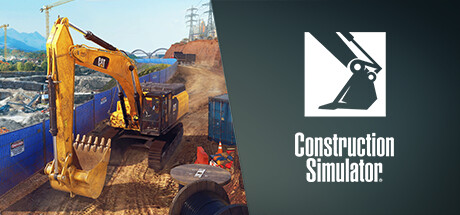

**Construction Simulator puts you in the cab of a massive range of construction vehicles from major manufacturers, completing building contracts across realistic job sites. Features dozens of licensed machines including excavators, cranes, and concrete mixers.**

---

## 📖 About

Construction Simulator puts you in the cab of a massive range of construction vehicles from major manufacturers, completing building contracts across realistic job sites. Features dozens of licensed machines including excavators, cranes, and concrete mixers.

## ⚠️ Problems Without Trainer

| Problem | Status |
|---------|--------|
| **Machine Controls** — Each vehicle type has distinct and complex control schemes to master | ✅ Solved |
| **Grade Requirements** — Earthwork leveling to specification requires precise machine manipulation | ✅ Solved |
| **Material Delivery Timing** — Running out of materials mid-contract requires driving to purchase more | ✅ Solved |
| **Site Navigation** — Operating large machines in tight job sites without collision requires patience | ✅ Solved |

## ✅ Solution

The **Construction Simulator Trainer** solves all these issues by giving you complete control over the game.

## 🎯 Full Feature List

- Unlimited Resources
- God Mode / Invincibility
- Instant Skill Cooldown
- One-Hit Kill
- Freeze Game Timer
- Unlock All Items & Achievements
- Custom Speed Multiplier
- Save State Anywhere

## 🚀 Quick Start

1. **Disable Windows Defender** temporarily (trainer may trigger false positive)
2. Download the trainer from the button above
3. Launch Construction Simulator
4. Run the trainer as Administrator
5. Activate desired cheats with hotkeys

## 💎 Free vs Paid

| Feature | Free | Pro |
|---------|------|-----|
| Basic God Mode | ✅ | ✅ |
| Unlimited Resources | ✅ | ✅ |
| All Advanced Cheats | ❌ | ✅ |
| Auto-Updates | ❌ | ✅ |
| Priority Support | ❌ | ✅ |

## 💻 Requirements

- Windows 10/11 (64-bit)
- Construction Simulator (any version)
- .NET Framework 4.8+
- DirectX 11+

## 🍎 macOS

macOS users can use our alternative tool:

## ⚖️ Legal

This trainer is for educational and single-player use only. Use responsibly.

---

